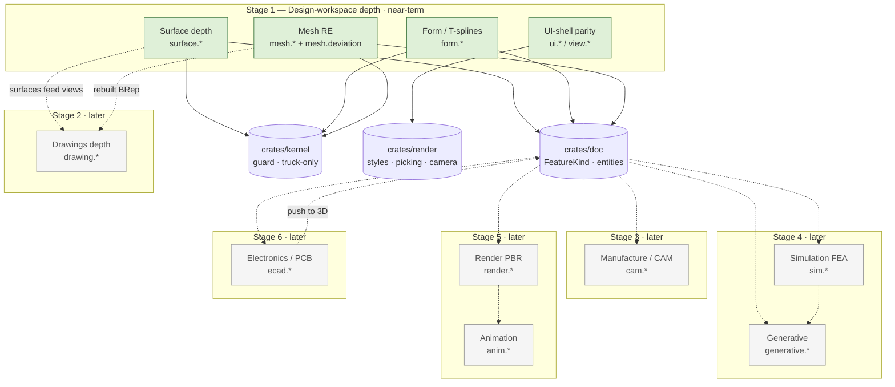

# Design — Fusion 360 Feature Parity

## Introduction

This document turns the staged parity requirements into a concrete architecture grounded in
SolidCraft's actual crates. It is deliberately **seed-first**: every "deferred" Fusion workspace
already carries a shallow set of real commands (`surface.*`, `form.*`, `mesh.*`, `drawing.*`,
`cam.contour`). The design treats those as seeds to **deepen** — new logic hangs off the existing
`FeatureKind` variants, command ids, and document entities, and existing command ids and saved
`.solidcraft` designs keep working. Nothing here proposes a greenfield rewrite.

Stage 1 (Surface depth, Form/T-splines, Mesh reverse-engineering, UI-shell parity) is specified
concretely because it is the near-term shippable work. Stages 2–6 are architectural sketches with
named seams and are explicitly marked **later-phase**.

The language throughout is Rust (the workspace is pure Rust: `crates/*` + `apps/*`).

---

## Architecture

### Where each stage lives in the layering

SolidCraft's layering is enforced by `cargo xtask layers`:

```
L0  geom        pure math: Vec2/Vec3, Plane, Region2, bspline, tspline
L1  sketch      constraint solver, sketch entities
    kernel      B-rep via truck (the ONLY crate that may use truck); guard(); mesh/tspline/freeform
    render      camera, picking rays, CPU rasterizer, (later) visual styles
L2  doc         Document, FeatureKind timeline, eval -> Model/ModelState, drawings, cam jobs
L3  io          .solidcraft container (solidcraft-container/1), STEP/IGES/3MF/STL/OBJ/DXF/SVG
L4  engine      Session, CommandSpec registry (cmd/*), catch_unwind, crash reports
L5  ui-egui     thin panels; theme::Tokens; swappable
    apps        solidcraft (desktop), solidcraft-cli, solidcraft-web (wasm), mcp
```

The staged work maps onto these layers as follows. A cell names the crate that owns the new or
deepened logic.

| Stage | geom (L0) | kernel (L1) | render (L1) | doc (L2) | io (L3) | engine (L4) | ui-egui (L5) |
|---|---|---|---|---|---|---|---|
| **1 Surface** | — | deepen patch/trim/stitch/thicken | — | `FeatureKind` variants already exist; extend fields | round-trip tags | deepen `surface.*` | contextual panel (thin) |
| **1 Form/T-spline** | `tspline`, `freeform` math already present | `tspline`/`formbody`/`freeform` deepen; caps | — | `FeatureKind::Form` → richer cage model | version bump + migration | deepen `form.*` | sculpt handles (thin) |
| **1 Mesh RE** | — | `meshbody`/`mesh_convert` deepen; `remesh`; deviation | — | mesh `FeatureKind` variants | — | deepen `mesh.*` + `mesh.deviation` | inspect panel (thin) |
| **1 UI-shell** | — | — | **visual styles**, camera orientations, picking modes/filters | selection/filter state is read-only | — | `ui.*` quick-toolbox, context menu, repeat-last | S-toolbox, marking menu, ViewCube, style switch |
| **2 Drawing** | 2D projection helpers | hidden-line/section curve extraction | — | `DrawingSheet` depth (views/dims/BOM) | SVG/DXF/PDF out | deepen `drawing.*` | sheet panel |
| **3 CAM** | 2D offset helpers | toolpath geometry (own) | — | `CamJob` → setups/ops | G-code text | deepen `cam.*` | CAM panel |
| **4 FEA / Generative** | mesh/grid math | own or non-GPL solver seam | result overlay | study entities | — | `sim.*`, `generative.*` | result panels |
| **5 Render / Animation** | — | — | PBR path, frame capture | appearances (reuse), storyboard | image/video out | `render.*`, `anim.*` | preview panels |
| **6 Electronics** | 2D geometry | — | — | schematic/PCB entities | ECAD public formats | `ecad.*` | ECAD panels |

Two layering rules bound everything:

- **Only `crates/kernel` touches `truck`.** New surface/form/mesh math that needs the B-rep
  kernel lives in `crates/kernel` behind `guard`. `doc` and above call kernel functions, never
  `truck` directly.
- **Nothing below `apps` depends on egui/eframe/winit/wgpu/rfd.** UI-shell features that are
  "view only" (visual styles, camera orientation, picking) put their *math* in `render` (L1) and
  keep the egui wiring in `ui-egui` (L5), so the shell stays swappable.

### Everything is a command

Every new user-visible behaviour is a `CommandSpec` in `crates/engine/src/cmd/*` with SolidCraft's
own dotted lower-case id. The existing `CommandSpec` builder is reused verbatim:

```rust
CommandSpec::new("surface.offset", "Offset Surface", offset)
    .at("SURFACE", "CREATE")
    .icon("offset")
    .params("bodies: [surface names]; distance: expr; ...");
```

Programmatic `engine.execute` runs the JSON `run`; only `ui.start` begins an interactive tool.
Deepening a seed means either adding fields to an existing `FeatureKind` variant (behind
`#[serde(default)]` so old designs still load) or adding a sibling command with a new id — never
renaming or removing an existing id.

### Command flow (unchanged, reused)

```
JSON / toolbar click
   │
   ├─ ui.start ──────────▶ interactive tool ──▶ app.run(id, params)
   │                                               │
   └─ engine.execute(id, params) ──────────────────┤
                                                    ▼
                             Session::execute  (catch_unwind — last-resort guard)
                                                    │
                                 (spec.enabled)?  ──┤
                                                    ▼
                                        spec.run(session, params)
                                                    │
                      doc.features.push(FeatureKind{..})   (undoable step)
                                                    │
                                   Model::refresh (incremental eval)
                                                    │
                     solidcraft_kernel::guard("op", || truck work)   ← panic → KernelError
                                                    ▼
                                      ModelState (bodies, solved sketches)
```

Every kernel call sits inside `guard`; `Session::execute` wraps the whole command in
`catch_unwind` and restores the design on an escaped panic, reporting `EngineError::Internal`.
This is the existing machinery; new commands plug into it rather than adding new error paths.

---

## Stage 1 — concrete design

Stage 1 closes the Design-workspace gap. It is four sub-areas: Surface depth, Form/T-splines,
Mesh reverse-engineering, and UI-shell parity.

### 1A. Surface workspace depth (Requirement 3)

**Owning crates:** `crates/kernel` (B-rep surface ops, all behind `guard`), `crates/doc`
(`FeatureKind` variants, already present), `crates/engine/src/cmd/surface.rs` (deepen).

**Current seed.** `surface.rs` already registers `surface.patch`, `surface.stitch`,
`surface.thicken`, `surface.extend`, `surface.trim`, `surface.untrim`, and the wall-wrappers
`surface.extrude/revolve/sweep/loft` (which run the solid command then keep the side walls via
`FeatureKind::SheetWalls`). The matching `FeatureKind` variants (`Patch`, `Stitch`, `Thicken`,
`SurfaceExtend`, `SurfaceTrim`, `SheetWalls`) already exist in `doc::document`.

**Deepening work.**

1. **Create-as-surface fidelity.** The seed produces surface extrude/revolve/sweep/loft by
   running the solid command and discarding caps (`SheetWalls`). Deepen so a surface create is a
   first-class open body (open profiles allowed, no implicit cap), driven by the existing
   `operation` and `extent` fields. New kernel helper `surfaces::open_sweep` next to the existing
   `surfaces::surface_body`. **Requirement 3.1.**
2. **Patch** already spans planar sketch regions and non-planar edge loops (one smooth B-spline
   face). Deepen boundary handling: accept mixed edge+sketch boundaries and guide curves. No new
   id. **Requirement 3.2.**
3. **Trim / untrim** round-trip is seeded (`surface.untrim` deletes the latest `SurfaceTrim`).
   Deepen `trim` to accept a surface/curve tool in addition to a plane, keeping `keep` semantics.
   **Requirement 3.3.**
4. **Stitch** already yields a solid when the faces close and a surface otherwise; deepen the
   tolerance-driven sewing in `kernel::sew`, reporting the gap edges that prevented closure.
   **Requirement 3.4.**
5. **Thicken** is seeded (symmetric/signed, new/join/cut/intersect via `operation`+`targets`).
   Deepen to multi-body and non-planar surfaces via `kernel::offset`. **Requirement 3.5.**
6. **New sibling commands** where a capability has no seed: `surface.offset` (offset a surface by
   a distance), `surface.rule` (ruled surface between two edges/curves). Each is a new dotted id
   with its own `FeatureKind` variant added behind `#[serde(default)]`.

**Kernel/guard.** Every B-rep call (sew, offset, loft, patch surface fit) routes through
`solidcraft_kernel::guard("surface.<op>", || …)`. A `truck` panic becomes
`KernelError::Internal`, surfaced by the command as an `Err`. No surface code calls `truck`
outside the kernel crate.

**Unsupported configs.** A requested option the kernel cannot yet honour returns
`Err(bad(cmd, "not supported yet: <what>"))` and leaves `doc.features` untouched
(**Requirement 3.6**). This reuses the existing `bad()` helper from `crate::params`.

**wasm.** All of `geom`, `kernel`, `doc`, `io`, `engine` already build for
`wasm32-unknown-unknown`; the new kernel helpers use only `truck` + `std` math (no threads, no
file I/O), so `cargo xtask wasm` stays green.

### 1B. Freeform / T-spline modelling (Requirement 4)

**Owning crates:** `crates/geom` (`tspline`, already present), `crates/kernel`
(`tspline`/`formbody`/`freeform`, already present), `crates/doc` (`FeatureKind::Form`,
`FormPull`), `crates/engine/src/cmd/form.rs` (deepen).

**Current seed.** `form.rs` registers `form.create` (box|cylinder, length/width/thickness) and
`form.pull` (move one of 16 grid points). The body is a pulled 4×4 grid thickened into a solid.
The kernel already has a real T-spline sheet builder (`kernel::tspline::tspline_sheet`, built on
`geom::tspline::TSpline`), plus `formbody` and `freeform` modules. **The T-spline machinery
exists; the Form command set is the shallow part.**

**Deepening work — the cage model.** Replace the fixed 4×4 pull list with a general editable
control cage stored on the `Form` feature. Because `FeatureKind::Form` is part of the serialized
document, this is a **format change** handled by migration (see "Document & format"):

```rust
// doc::document — Form feature deepened. Old fields kept with #[serde(default)]
// so solidcraft-container/1 designs still load.
Form {
    shape: String,                 // box | cylinder  (seed field)
    length: String,
    width: String,
    thickness: String,
    #[serde(default)]              // legacy 4×4 grid pulls still deserialize
    pulls: Vec<FormPull>,
    #[serde(default)]              // NEW: general cage edits, replayed in order
    edits: Vec<FormEdit>,
    #[serde(default)]
    symmetry: Option<PlaneRef>,    // NEW: mirror plane for symmetric sculpting
    #[serde(default)]
    creases: Vec<CageEdgeRef>,     // NEW
}

#[derive(Clone, Debug, PartialEq, Serialize, Deserialize)]
#[serde(tag = "op", rename_all = "snake_case")]
enum FormEdit {
    Move { targets: Vec<CageVertRef>, delta: Vec3 },
    InsertEdge { between: (CageVertRef, CageVertRef) },
    Subdivide { faces: Vec<CageFaceRef> },
    Bridge { a: CageFaceRef, b: CageFaceRef },
}
```

**New commands** (sibling ids; the seed `form.create`/`form.pull` stay): `form.edit_point`,
`form.insert_edge`, `form.subdivide`, `form.bridge`, `form.crease`, `form.symmetry`,
`form.finish`. Each appends a `FormEdit` (or sets `symmetry`/`creases`) and re-evaluates through
the existing `kernel::tspline_sheet` / `freeform` path. `form.finish` converts the cage to a
solid or surface body usable downstream (**Requirement 4.4**).

**Re-evaluability.** Edits are stored declaratively on the feature and replayed in order on every
`Model::refresh`, so the form stays editable from the timeline (**Requirement 4.2**) and
re-evaluation is deterministic.

**Symmetry & crease.** `symmetry` mirrors every edit across the plane during evaluation so the
body stays symmetric; `creases` sharpen cage edges before the smooth sheet is built
(**Requirement 4.3**).

**Hostile-input caps (Requirement 4.5).** The seed already caps pulls (`take(64)`, index ≤ 15).
Deepen with explicit caps enforced in the command before any kernel call:

```rust
const MAX_CAGE_VERTS: usize = 20_000;
const MAX_SUBDIV_LEVEL: u32 = 6;
const MAX_EDITS: usize = 10_000;
```

A request past a cap returns `Err(bad(cmd, "not supported yet: cage too large"))` (or a plain
cap error) **before** allocating, so extreme input cannot exhaust memory or hang. These are
input-derived numbers and are treated as hostile: finite checks, `get()` not `[i]`, bounded loops.

**Unsupported ops** return `"not supported yet: …"` and leave the design unchanged
(**Requirement 4.6**).

### 1C. Mesh reverse-engineering (Requirement 5)

**Owning crates:** `crates/kernel` (`meshbody`, `mesh_convert`, already present),
`crates/doc` (`MeshConvert`, `MeshCut`, `MeshRepair`, `MeshReduce` variants, already present),
`crates/engine/src/cmd/mesh.rs` (deepen).

**Current seed.** `mesh.rs` registers `mesh.convert` (prismatic|faceted), `mesh.plane_cut`,
`mesh.repair`, `mesh.reduce`, `mesh.face_groups`, `mesh.section`. Import already creates a mesh
body (file I/O, **Requirement 5.1**).

**Deepening work.**

1. **Section (5.2)** is seeded (slices triangles against a plane, builds a sketch polyline).
   Deepen: build multiple closed loops (not one chain), ordered and de-duplicated, so the result
   is directly usable as a reconstruction reference.
2. **Face groups (5.3)** are seeded (group by dominant normal axis). Deepen to region growing by
   dihedral angle so groups correspond to real faces; the groups must **partition** all
   triangles.
3. **Convert (5.4)** is seeded (prismatic merges coplanar facets within tolerance; faceted keeps
   one face per triangle). Deepen prismatic to recognize cylindrical regions via
   `kernel::plane_fit`-style fitting. Faceted stays `face_count == triangle_count`.
4. **Plane cut / reduce / repair (5.5)** are seeded; **add `mesh.remesh`** (new id,
   `FeatureKind::MeshRemesh` behind `#[serde(default)]`). All bound triangle and loop counts
   against hostile sizes with explicit caps (`MAX_MESH_TRIS`), returning an error past the cap.
5. **Deviation compare (5.6) — new command `mesh.deviation`.** Measures the max/mean distance
   between a rebuilt BRep body and its source mesh and reports it as a number. Kernel helper
   `kernel::measure`-adjacent `mesh_deviation(brep, mesh) -> Result<Deviation>`; the command is
   read-only (`.noundo()` like `mesh.face_groups`).

**Caps & never-crash (5.7).** Triangle/loop counts are capped before kernel work; over-cap or
unsupported returns an error and leaves the design unchanged. Mesh math runs inside `guard`.

**wasm.** Mesh ops are pure geometry over vertex/triangle arrays — wasm-clean.

### 1D. UI-shell parity (Requirement 2)

**Owning crates:** `crates/render` (L1) owns the *math* for visual styles, camera orientation,
and picking modes/filters so the behaviour is testable and the shell stays swappable;
`crates/engine/src/cmd/ui.rs` and `view.rs` own the commands; `crates/ui-egui` (L5) owns the thin
widgets.

> This overlaps the `ux-ui-shell-improvements` spec. Where that spec already delivers a widget,
> this spec **consumes** it (reads engine state, runs commands) rather than reimplementing it.

**Quick-toolbox (2.1).** A command that searches the registry. The search is a pure function over
`command_specs()` and a query — it belongs in `engine` (or `render`-independent) and is trivially
testable. The egui panel in `ui-egui` lists results and calls `app.run(id, params)` /
`app.start(id)`. No behaviour bypasses `CommandSpec`.

**Context menu / repeat-last (2.2).** A pure builder `context_menu(selection, &registry) ->
Vec<CommandInfo>` returns only commands whose `enabled(session)` holds for the current selection,
plus a synthetic Repeat-last entry resolving to the last executed id. The menu runs entries
through the command layer.

**View-orientation widget / ViewCube semantics (2.3).** Camera math lives in `render`. A new
`render` function maps each of the 26 standard/diagonal directions to a camera orientation with
world **Z up preserved**, consistent with the existing axis navigation. The command is in
`view.rs` (`view.orient { direction }`).

**Selection modes & filters (2.4, 2.5).** Picking resolution is pure over a ray + candidate set
and already partly lives in `render`. Deepen:

```rust
// render — pure, deterministic, swappable-shell-safe
enum SelectMode { Entity, Body, Occluded }   // occluded picks resolved by sorted depth
struct SelectFilter { faces: bool, edges: bool, vertices: bool,
                      sketch_curves: bool, bodies: bool, components: bool }
fn pick(ray: Ray, candidates: &[Pickable], mode: SelectMode, filter: SelectFilter)
    -> Option<Pickable>;   // returns only permitted kinds; deterministic ordering
```

The engine holds the current mode/filter as session state; `ui.*` commands set them.

**Visual styles (2.6).** `render` gains a `VisualStyle { Shaded, ShadedEdges, HiddenEdges,
Wireframe }` that drives the rasterizer and the GPU viewport. Switching style changes **only
render parameters** — it must not touch `doc.features` or the evaluated `ModelState`. The style is
a view setting, not a document edit (so it is not undoable and not serialized into the design).

**Thinness & invalid targets (2.7, 2.8).** The shell reads engine state and acts through
`app.run`/`app.start`; colours come from `theme::Tokens` (the existing `ui-egui::theme::Tokens`).
A shell action on a vanished/invalid entity returns an `Err` from the command and leaves the model
and pending input unchanged — never panicking, guaranteed by `Session::execute`'s `catch_unwind`
and the per-command validation that already returns `bad(cmd, …)` on missing bodies.

---

## Stages 2–6 — later-phase architectural sketches

These are intentionally lighter. Each names its seam so Stage 1 does not foreclose it. All are
independently shippable and may be re-prioritized by the owner (**Requirement 1.3**).

### Stage 2 — 2D Drawings depth (Requirement 6)

- **Seed:** `drawing.*` (`create`, `base_view`, `project`, `section`, `dimension`, `export_svg`)
  and the `DrawingSheet`/`DrawingView`/`DrawingNote` entities in `doc`.
- **Seam:** deepen `DrawingSheet` with associative views (projected/section/detail derived from a
  base view), associative dimensions/center-marks/annotations, a title block, and a parts-list/BOM
  populated from the component structure with balloons linked to rows. Hidden-line and section
  curve extraction is a `kernel` projection of the evaluated bodies to a view plane (L1 math in
  `geom`/`kernel`, never `truck` outside `kernel`).
- **Standards & templates:** ISO/ASME-style first/third-angle and arrow styles come from
  **SolidCraft-original** templates only; no vendor templates or symbols.
- **Export:** SVG is seeded; DXF/PDF derived from public specs in `io`.
- **Lost references (6.7):** a view updates what it can and reports the lost reference; never panic.

### Stage 3 — Manufacture / CAM depth (Requirement 7)

- **Seed:** `cam.contour` and the `CamJob` entity in `doc`.
- **Seam:** promote `CamJob` into setups (WCS + stock + target bodies) owning 2D ops
  (contour/pocket/drill) and 3D ops (surface paths with stepover). Toolpath geometry is
  **SolidCraft-authored** 2D offset / scallop math in `geom`/`kernel`.
- **Hole recognition:** cylindrical-face detection reusing the kernel's surface-kind analysis.
- **Post:** a configurable, SolidCraft-authored G-code post in `io`/`engine`; **no vendor
  post-processor files** copied.
- **Simulation:** report removed/remaining stock as a measured volume.

### Stage 4 — Simulation (FEA) & Generative Design (Requirements 8, 9)

- **Seam:** a `sim` study and a `generative` study, each a `doc` entity capturing target body,
  material, constraints, loads / preserve-obstacle regions, objective.
- **Solver policy (non-negotiable):** the solver is **SolidCraft's own** or an **openly licensed,
  non-GPL** dependency, and the method used is **recorded** on the result. Candidate approaches to
  evaluate (none required, none GPL): a from-scratch linear-tetra/hexa FEA assembled in Rust with
  a permissively licensed sparse solver (e.g. an MIT/Apache conjugate-gradient or sparse-LU
  crate), and a topology/lattice generative method built on SolidCraft's own voxel/mesh grid.
  **We will never read, link, or vendor GPL/LGPL/AGPL FEA or generative code.**
- **Result overlay:** colour map in `render`; min/max reported; geometry unchanged.
- **Honesty:** under-constrained / unsupported / over-cap → report and **refuse misleading
  results**; never panic.

### Stage 5 — Render (PBR) & Animation (Requirements 10, 11)

- **Seam:** reuse the existing appearance targeting (`doc::appearance`) for PBR appearances
  (base colour, metalness, roughness); a render path in `render` produces an image file; a
  storyboard reuses the existing motion-study and exploded-view machinery for keyed poses and
  auto-explode, publishing a video or image sequence through `io`.
- **Assets:** every shipped material/environment asset is original or openly licensed with a row
  in `ATTRIBUTION.md` (enforced by `cargo xtask assets`); a missing asset falls back to a default
  and is reported, never a panic.

### Stage 6 — Electronics / PCB (Requirement 12)

- **Seam:** schematic (components + nets) and PCB (layout) as `doc` entities; ERC/DRC as
  read-only checks reporting issues without modifying the design; push-to-3D produces a PCB body
  placeable as a mechanical component; ECAD import/export via **public-specification** formats
  only, using openly licensed or SolidCraft-original part data.

---

## Components and interfaces

### New / extended document entities (data model)

All new `FeatureKind` variants follow the existing serde convention
(`#[serde(tag = "type", rename_all = "snake_case")]`), and every new field carries
`#[serde(default)]` (and `skip_serializing_if` where natural) so that `solidcraft-container/1`
designs round-trip unchanged. Summary of Stage 1 additions:

| Entity | Crate | Status | Notes |
|---|---|---|---|
| `FeatureKind::Form { .., edits, symmetry, creases }` | doc | extend existing | legacy `pulls` kept via `#[serde(default)]` |
| `FormEdit`, `CageVertRef`, `CageFaceRef`, `CageEdgeRef` | doc | new | tagged enum / small ref structs |
| `FeatureKind::SurfaceOffset`, `SurfaceRule` | doc | new | sibling of existing surface variants |
| `FeatureKind::MeshRemesh` | doc | new | sibling of existing mesh variants |
| `Deviation { max, mean }` (result, not a feature) | doc/kernel | new | returned by `mesh.deviation` |
| `VisualStyle`, `SelectMode`, `SelectFilter` | render | new | **view state, not serialized into the design** |

### Command surface (CommandSpec ids)

All ids are SolidCraft's own dotted lower-case ids; existing ids are preserved.

- **Surface (deepen + add):** keep `surface.patch|stitch|thicken|extend|trim|untrim|extrude|
  revolve|sweep|loft`; add `surface.offset`, `surface.rule`.
- **Form (deepen + add):** keep `form.create|pull`; add `form.edit_point`, `form.insert_edge`,
  `form.subdivide`, `form.bridge`, `form.crease`, `form.symmetry`, `form.finish`.
- **Mesh (deepen + add):** keep `mesh.convert|plane_cut|repair|reduce|face_groups|section`; add
  `mesh.remesh`, `mesh.deviation`.
- **UI-shell:** `ui.quick_toolbox`, `ui.context_menu`, `ui.repeat_last`, `ui.select_mode`,
  `ui.select_filter`, `view.orient`, `view.visual_style` (exact placement per
  `ux-ui-shell-improvements`; consume where that spec already provides it).

### Kernel interfaces (all behind `guard`, only in `crates/kernel`)

```rust
// surfaces.rs / offset.rs / sew.rs — deepened
pub fn open_sweep(profile: &Region2, ...) -> Result<Body>;        // true open surface
pub fn surface_offset(body: &Body, distance: f64) -> Result<Body>;
pub fn stitch_tolerant(bodies: &[Body], tol: f64) -> Result<Stitched>; // solid or surface + gap report

// tspline.rs / formbody.rs / freeform.rs — deepened
pub fn form_sheet(cage: &Cage, creases: &[..], symmetry: Option<Plane>) -> Result<Body>;

// meshbody.rs / mesh_convert.rs — deepened + new
pub fn mesh_remesh(mesh: &Body, target: usize) -> Result<Body>;
pub fn mesh_deviation(brep: &Body, mesh: &Body) -> Result<Deviation>;
```

Each is called by a command like:

```rust
let body = solidcraft_kernel::guard("surface.offset",
    || solidcraft_kernel::surface_offset(&src, dist))?;   // panic → KernelError::Internal
```

---

## Document & format

The on-disk container is `solidcraft-container/1` (`crates/io/src/design.rs`), with a legacy
`solvecraft-container/1` compatibility tag already handled. The document model is versioned by the
serde shape of `FeatureKind`.

**Backward compatibility strategy.** The existing scheme is "add-only with defaults":

- New `FeatureKind` **variants** are additive — older builds use `#[serde(deny_unknown_fields)]`
  only on specific inner structs (e.g. `FlangeEdge`), not on `FeatureKind`, so a design that uses
  a new variant simply won't load in an *older* binary, which is acceptable (forward designs on
  old builds). A **newer** binary always reads **older** designs.
- New **fields** on an existing variant (the `Form` deepening) use `#[serde(default)]`, so a
  `solidcraft-container/1` design with the old 4×4 `pulls` loads into the deepened `Form` with
  `edits = []`, `symmetry = None`, `creases = []`, and evaluates to the same body.

**When a format tag bump is warranted.** If the Form cage model changes the *meaning* of existing
`pulls` (it does not — `pulls` is retained and still replayed), or if an entity cannot be expressed
additively, bump to `solidcraft-container/2` and add a migration that upgrades `/1` on load. The
migration lives in `crates/io` next to the container reader, is covered by a corpus test (old
design loads and re-evaluates to an equivalent model), and is listed in `docs/compatibility.md`.
Stage 1 as designed is **additive only**, so no bump is required; the bump path is documented so
later stages (new `doc` entities for CAM setups, studies, drawings depth) have a clear route.

`ROADMAP.md` and `docs/features.md` (via `cargo xtask features`) are updated whenever commands are
added or renamed (**Requirement 1.6**).

---

## Error handling

The repo's never-crash rules are the backbone of the design; no new error path is invented.

- **Result everywhere.** Every command returns `Result<Value>`; errors flow through the engine
  error type and `?`. No `unwrap`/`expect`/`panic!`/`unreachable!`/`todo!`/`unimplemented!` and no
  `unsafe` in non-test code. The crate roots keep
  `#![deny(clippy::unwrap_used, clippy::expect_used, clippy::panic, …)]` and
  `unsafe_code = "forbid"`.
- **Unfinished features return an error**, never a panic: `Err(bad(cmd, "not supported yet: …"))`
  with context, leaving `doc.features` unchanged.
- **Input-derived numbers are hostile.** Command params, design-file values, and control-channel
  input get finite checks, `get()` indexing, and explicit caps (cage verts, subdivision level,
  mesh triangles, loop counts, toolpath sizes). The seeds already do this (`take(64)`, index ≤ 15,
  `tool < 1e5`); the deepened commands extend the same discipline.
- **Third-party kernel calls are guarded.** All `truck` work goes through
  `solidcraft_kernel::guard`, turning a kernel panic into `KernelError::Internal`.
- **Last-resort guard.** `Session::execute` runs each command under `catch_unwind`, restores the
  design, and reports `EngineError::Internal` on an escaped panic.
- **Crash reports.** Any panic or unclean exit is written to the local crash folder with the
  design and reproducing commands; a fix lands with a regression test seeded from the report's
  `design.solidcraft` + `replay.json` (as with `hostile_params_never_panic`).

---

## Non-negotiables — how the design satisfies them

- **Independent / clean-room.** All behaviour is from public CAD conventions and public format
  specs. No command ids, icons, artwork, help text, templates, or reference data from any
  commercial product. Icons for new commands are **drawn in code** (`ui-egui/src/icons.rs`); any
  file asset gets an `ATTRIBUTION.md` row (enforced by `cargo xtask assets`).
- **No commercial CAD products** are driven, scripted, or used for any test data, ids, or files.
- **No GPL/LGPL/AGPL** sources are read, copied, or linked. FEA/Generative/CAM/Electronics use
  SolidCraft-own methods or **openly licensed non-GPL** dependencies, with the method recorded;
  candidate approaches are named above but **none is required and none is GPL**. The FreeCAD
  oracle runs only as a **separate program** via its public scripting API to compute reference
  values — nothing linked or vendored.
- **Everything is a command** via `CommandSpec`; programmatic `engine.execute` never opens dialogs.
- **Layering** respected: only `kernel` uses `truck`; visual-style/picking/camera *math* sits in
  `render` (L1) and keeps `ui-egui` (L5) swappable; nothing below `apps` depends on egui/winit/wgpu.
- **wasm:** every crate below `apps` keeps building for `wasm32-unknown-unknown`
  (`cargo xtask wasm`).
- **Units:** millimetres and radians internally; Z is up (the new `view.orient` preserves Z-up).
- **Quality gates:** `cargo xtask ci` (fmt, clippy -D warnings, tests, assets, layers, wasm) stays
  green before every commit.
- **Evidence:** observable behaviour is captured by driving the app through the control channel
  (`ui.screenshot` / `ui.render` / `solidcraft-cli snapshot`), not by asking a human.

---

## Staged dependency flow



Solid arrows are Stage-1 crate dependencies that exist today. Dotted arrows are later-phase
consumption seams: each later stage reads `doc`/`kernel` output but adds no dependency that blocks
Stage 1, so stages stay independently shippable.

---

## Testing / verification strategy

The strategy mirrors the repo's existing conventions: unit tests next to code, oracle reference
tests, hostile-parameter fuzz, and headless-UI / control-channel screenshots. Both example-based
and property-based tests are used; they are complementary.

### Unit + example tests

- Co-located `#[cfg(test)]` modules (as in `surface.rs`, `form.rs`, `mesh.rs` today) cover
  specific examples, edge cases, and integration points — e.g. the existing
  `patch_trim_thicken_and_stitch` and `untrim_drops_the_latest_trim` tests, extended for the new
  surface/form/mesh commands.
- Keep unit tests focused on concrete examples and error conditions; let property tests carry
  broad input coverage.

### Property-based tests (≥100 iterations each)

Each property test references its design property with the tag
**`Feature: fusion360-feature-parity, Property {n}: {text}`** and uses ≥100 generated inputs.
Generators produce valid profiles, cages, meshes, selection sets, and hostile params. See the
Correctness Properties section below for the properties themselves.

### Oracle / analytic reference tests

- `cargo xtask oracle` replays `tests/oracle/*/recipe.json` and compares against each case's
  `expected.json`. New Stage-1 cases: a patched planar region's area (analytic shoelace), a
  thickened surface's volume (`area × thickness`), a surface closed by stitch then measured
  (analytic solid), a faceted mesh conversion's face count, and a mesh-section point set lying on
  the cut plane.
- **Expected values come only from analytic math or the FreeCAD oracle run as a separate
  program** (`tools/freecad-oracle/`). **Never from a commercial CAD product.**

### Hostile-parameter fuzz (never-crash)

- Extend the existing `hostile_params_never_panic` discipline (`crates/kernel/src/fuzz.rs`,
  `apps/solidcraft-cli/tests/fuzz_range.rs`) to the new surface/form/mesh commands: generate
  garbage params (non-finite numbers, huge counts, missing bodies, invalid selections) and assert
  every call returns `Err` and never panics (`guarded()` catches kernel panics;
  `Session::execute`'s `catch_unwind` catches the rest). A crash report's
  `design.solidcraft` + `replay.json` becomes a regression test.

### Headless-UI / control-channel evidence

- Drive the app with JSON lines on the control channel
  (`cargo run --release -p solidcraft -- --sample --control PORT`, under `Xvfb :99` when
  headless): `engine.execute` for the new commands, `ui.start` + `ui.click` for the shell,
  `ui.screenshot` / `ui.render` / `solidcraft-cli snapshot` to capture before/after images for
  each observable change (surface create, form sculpt, mesh convert, visual-style switch,
  ViewCube orient). Screenshots are attached to the PR/issue, **not committed**.

### Standard-workflow validation (Requirement 13)

- Each Fusion standard workflow is scripted as a control-channel / CLI recipe that runs only
  registered commands end-to-end (parametric mechanical part; mesh reverse-engineering with
  deviation; design-for-manufacturing parameter propagation; assembly-and-motion with limits and
  interference). Every step must complete through a `CommandSpec`; a timeline edit must
  re-evaluate dependents; no step may panic; unsupported steps return `"not supported yet: …"`
  and leave a consistent state (**Requirement 13.6**). Results are captured as screenshots/recording.

---

## Correctness Properties

*A property is a characteristic or behavior that should hold true across all valid executions of
the system — a formal statement about what the system should do. Properties bridge human-readable
specifications and machine-verifiable correctness guarantees.*

Per the prework, the many per-command "unsupported → not supported yet / no panic / unchanged"
criteria are consolidated into two reusable properties (P1, P2). Stage-1 capabilities get
concrete, executable properties (P3–P16). Stage 2–6 properties are recorded as **later-phase**
(P17–P24) so no capability is silently dropped (**Requirement 1.3/1.4**); they become executable
when those stages are implemented.

### Property 1: Hostile input never crashes and leaves the design unchanged

*For any* command id and *any* parameter value (including non-finite numbers, oversized counts,
missing bodies, and invalid or stale selection targets), executing the command either succeeds or
returns an `Err`; it never panics, and on error the document (`doc.features` and parameters) is
byte-for-byte unchanged.

**Validates: Requirements 2.8, 3.7, 4.5, 5.7, 6.7, 7.7, 8.5, 9.4, 10.4, 11.5, 12.6, 13.6**

### Property 2: Unsupported options are reported, not performed

*For any* command given an option value the kernel cannot yet honour, the result is an `Err` whose
message contains `"not supported yet"`, and the document is unchanged.

**Validates: Requirements 3.6, 4.6**

### Property 3: Surface-create yields a zero-thickness surface and one timeline feature

*For any* valid closed profile and *any* surface-create command (`surface.extrude`,
`surface.revolve`, `surface.sweep`, `surface.loft`), the resulting body is a surface (not a solid)
and exactly one timeline feature is appended.

**Validates: Requirements 3.1**

### Property 4: Planar patch area equals the enclosed area

*For any* planar closed boundary (sketch region or coplanar edge loop), `surface.patch` produces a
single face whose area equals the analytic enclosed (shoelace) area within tolerance; a non-planar
closed loop produces exactly one smooth face.

**Validates: Requirements 3.2**

### Property 5: Trim then untrim restores the surface

*For any* surface body, cutting tool, and keep point, applying `surface.trim` and then
`surface.untrim` restores the original surface (same face set and area within tolerance).

**Validates: Requirements 3.3**

### Property 6: Stitch closes to a solid exactly when the faces bound a volume

*For any* set of surface faces, `surface.stitch` yields a solid body if and only if the faces
together bound a closed volume (the solid's volume matching the analytic value); otherwise it
yields a joined surface body.

**Validates: Requirements 3.4**

### Property 7: Thicken volume equals area times thickness

*For any* planar surface of area A and *any* finite thickness t, `surface.thicken` yields a solid
whose volume is within tolerance of A·|t|, placed on the correct side for the sign and centered
when symmetric.

**Validates: Requirements 3.5**

### Property 8: Form-create appends one evaluable feature for either start shape

*For any* valid length/width/thickness and *any* start shape in {box, cylinder}, `form.create`
appends exactly one `Form` feature that evaluates to a non-empty body.

**Validates: Requirements 4.1**

### Property 9: Cage edits re-evaluate deterministically and change the body

*For any* cage and *any* sequence of form edits, two evaluations of the same feature from the
timeline produce identical bodies (deterministic re-evaluation), and a non-zero pull/move changes
the body.

**Validates: Requirements 4.2**

### Property 10: Symmetric sculpting yields a symmetric body

*For any* form edit applied with symmetry plane P, the evaluated body is invariant under reflection
across P within tolerance.

**Validates: Requirements 4.3**

### Property 11: A finished form is a usable solid or surface

*For any* valid finished form, `form.finish` yields a body that is a solid or a surface and that a
downstream feature (e.g. an extrude-cut referencing it) can consume.

**Validates: Requirements 4.4**

### Property 12: Mesh-section points lie on the cut plane

*For any* mesh body and *any* plane that intersects it, every point produced by `mesh.section` lies
on the plane within tolerance; a non-intersecting plane returns an error.

**Validates: Requirements 5.2**

### Property 13: Face groups partition the mesh

*For any* mesh body, the groups from `mesh.face_groups` partition the triangles: the group counts
sum to the mesh triangle count and every triangle belongs to exactly one group.

**Validates: Requirements 5.3**

### Property 14: Mesh conversion face counts are correct per mode

*For any* mesh body, faceted `mesh.convert` yields a BRep body with `face_count` equal to the
triangle count; prismatic `mesh.convert` yields a BRep body with `face_count` ≤ the triangle count
(coplanar facets merged).

**Validates: Requirements 5.4**

### Property 15: Reduction does not increase triangle count and cut keeps one side

*For any* mesh body and *any* ratio in (0, 1], `mesh.reduce` yields a triangle count ≤ the
original; and *for any* plane and keep point, `mesh.plane_cut` keeps only the triangles on the keep
side.

**Validates: Requirements 5.5**

### Property 16: Deviation is finite, non-negative, and ~0 for an exact rebuild

*For any* mesh body, the deviation reported by `mesh.deviation` is finite and ≥ 0; and for a
faceted conversion of that mesh, the deviation is ~0 within tolerance.

**Validates: Requirements 5.6**

### Property 17: Visual-style switches never change geometry or timeline

*For any* design and *any* visual style (shaded, shaded-with-edges, hidden-edges, wireframe),
switching the style leaves `doc.features` and the evaluated body topology unchanged; only render
parameters differ.

**Validates: Requirements 2.6**

### Property 18: View orientation preserves Z-up

*For any* of the 26 standard/diagonal orientations, the camera computed by `view.orient` looks
along the chosen direction and projects world Z upward on screen (Z-up preserved).

**Validates: Requirements 2.3**

### Property 19: Selection respects mode and filter, deterministically

*For any* picking ray and candidate set, picking in a given mode and filter returns only entities
whose kind is permitted by the filter, resolves occluded picks by sorted depth, and returns the
identical result on repeated identical input (deterministic).

**Validates: Requirements 2.4, 2.5**

### Property 20: Quick-toolbox and context-menu entries resolve to valid commands

*For any* query string, every command the quick-toolbox returns matches the query and resolves via
the registry; and *for any* selection state, every context-menu entry resolves to a command whose
`enabled` predicate holds for that selection, with Repeat-last equal to the last executed command
id (or absent when none).

**Validates: Requirements 2.1, 2.2**

### Property 21: Documents round-trip across the deepened model

*For any* design in the corpus — including designs that use the seed `surface.*`, `form.*`,
`mesh.*`, `drawing.*`, and `cam.contour` commands — saving and reloading through the container
yields an equivalent document that re-evaluates to an equivalent model, and every baseline seed
command id remains registered.

**Validates: Requirements 1.4**

### Property 22 (later-phase): Drawing views and annotations are associative

*For any* model change, an associative drawing view and its dimensions/annotations re-derive from
the current geometry (projected points lie on the view plane; a dimension re-measures the changed
geometry), and a BOM's row quantities sum to the component instance count.

**Validates: Requirements 6.1, 6.2, 6.3, 6.4** — *realized when Stage 2 is implemented.*

### Property 23 (later-phase): Toolpaths and exports round-trip through public formats

*For any* 2D toolpath, every path point is offset from the profile by the tool radius and the depth
steps cover the full cut depth; and *for any* exported SVG/DXF/G-code, re-parsing the output
recovers the geometry/coordinates (round trip).

**Validates: Requirements 6.6, 7.2, 7.5** — *realized when Stages 2–3 are implemented.*

### Property 24 (later-phase): Analysis, render, and ECAD leave geometry unchanged and checks are sound

*For any* simulation/generative study, render, or animation, the operation does not alter the CAD
geometry or real component placements; animation interpolation reproduces the keyed poses at the
endpoints; generative candidates respect preserve/obstacle regions; and a DRC/ERC flags exactly
the violations implied by the clearance/connectivity rules.

**Validates: Requirements 8.3, 9.2, 10.3, 11.2, 11.3, 12.2, 12.3** — *realized when Stages 4–6 are implemented.*
